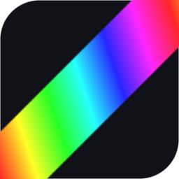

# MyRGB

Controle de iluminação RGB para placas ASUS AURA — **o mesmo programa, os mesmos
efeitos, no Linux e no Windows**.

O MyRGB fala diretamente com o protocolo HID do controlador AURA USB
(`0b05:19af`). Não é um wrapper do OpenRGB: é uma implementação própria do
protocolo, o que faz o comportamento ser idêntico nos dois sistemas
operacionais.



> **Documentação:** a pasta [`documentation/`](documentation/) explica o
> programa por dentro, o que cada parte da interface faz, o catálogo dos 50
> efeitos, as zonas e os perfis, e como desenvolver.

---

## O que ele faz

- **50 efeitos prontos**, organizados em 6 categorias (mais que o OpenRGB oferece).
- **Autoria visual de efeitos**: escolha um padrão, um gradiente e ajuste
  parâmetros por sliders — sem scripting, sem timeline.
- **Gradientes multi-parada** com interpolação em RGB ou HSV, editáveis
  arrastando as paradas.
- **Pré-visualização ao vivo** idêntica ao que sai no hardware (o preview
  consome o mesmo buffer de pixels que é enviado aos LEDs).
- **Perfis** salvos em JSON, com esquema idêntico nos dois sistemas — dá para
  copiar o arquivo de um para o outro.
- **Zonas independentes** (LED onboard + 3 headers ARGB), com opção de uma zona
  "seguir" outra, de **renomear** cada zona e de **aplicar o mesmo efeito em
  todas** de uma vez.
- **Ajuda embutida**: um **?** em cada painel e em cada parâmetro explica o
  que aquele controle faz.
- **Bandeja do sistema** com controle rápido das luzes.
- **Detecção de conflito contínua**: avisa quando outro programa (Armoury Crate,
  OpenRGB) também está controlando o mesmo controlador — inclusive se ele
  começou a rodar depois do app.
- **Dashboard de diagnóstico** (em construção): navegação lateral com Sistema,
  Sensores, Discos, Rede, Jogos, Gargalo, Overlay e Integrações, no visual
  monocromático do Reset Explode. As páginas entram fase por fase; a de
  Iluminação é a mesma de sempre.

### Estado do dashboard

| Página | Estado |
|---|---|
| Iluminação | pronta (tela original) |
| Visão geral, Sistema, Sensores, Discos, Rede, Jogos, Gargalo, Overlay, Integrações | esqueleto de navegação, conteúdo nas próximas fases |

O plano completo, com arquitetura, fases e critérios de aceite, fica no
arquivo de planejamento do projeto.


## Requisitos

| | |
|---|---|
| Placa | Qualquer ASUS com o controlador AURA USB (`0b05:19af`) |
| SO | Linux (x64) ou Windows (x64) |
| Node | 20+ para desenvolvimento |

O controlador AURA USB é o presente em placas ASUS a partir da geração
X470/Z390. É ele que controla os headers 5V endereçáveis e os LEDs onboard.

---

## Instalação no Linux

### 1. Permissão de acesso ao dispositivo

O controlador aparece como um dispositivo HID cru. Sem uma regra de udev, só o
root consegue abri-lo.

O `.deb` instala a regra sozinho durante o `dpkg -i`:

```bash
sudo dpkg -i release/my-rgb_0.1.0_amd64.deb
```

Depois, **desligue e religue o cabo do controlador** (ou reinicie) para que a
regra passe a valer.

Se você preferir instalar o AppImage, ou estiver instalando na mão, a regra
está em `packaging/linux/udev/60-my-rgb.rules`:

```bash
sudo cp packaging/linux/udev/60-my-rgb.rules /etc/udev/rules.d/
sudo udevadm control --reload-rules && sudo udevadm trigger
```

> Se você já usa o OpenRGB, a regra `/etc/udev/rules.d/60-openrgb-asus.rules`
> faz o mesmo trabalho — mas a do MyRGB é a que o projeto mantém.

### 2. Executar

```bash
npm install
npm run dev          # modo de desenvolvimento
```

Para gerar os instaladores:

```bash
npm run build:linux  # AppImage + .deb em release/
```

## Instalação no Windows

1. Instale o MyRGB (`MyRGB-<versão>-setup.exe`).
2. **Desative a iluminação do Armoury Crate / Aura Sync** — veja
   [documentation/windows.md](documentation/windows.md) para o passo a passo e
   para diagnosticar cintilação.

O instalador NSIS registra a entrada de autostart do Windows quando a opção
"Iniciar com o sistema" está ligada nas configurações do MyRGB.

---

## Usando

| Ação | Como |
|---|---|
| Escolher zona | Clique na zona na barra à esquerda |
| Escolher efeito | Grade de padrões, agrupados por categoria |
| Escolher gradiente | Seletor no topo do painel **Gradiente** |
| Ajustar | Os sliders aparecem sozinhos a partir dos parâmetros do padrão |
| Criar gradiente | Clique na barra do gradiente para adicionar uma parada; arraste para mover |
| Ligar/desligar | Botão **Luzes ligadas** na barra superior (o preview continua rodando) |
| Aplicar em todas as zonas | Botão **⇉ Aplicar a todas as zonas**, no topo da barra de zonas |
| Renomear uma zona | Botão **✎** no cartão da zona |
| Perfis | O perfil é salvo sozinho a cada alteração; **Salvar como…** cria uma cópia com outro nome, **✎** renomeia |

Cada zona tem o seu próprio efeito. O botão de olho/estilo no painel
**Gradiente** duplica uma paleta para você poder experimentar sem perder a
original.

Todos os painéis têm um **?** que explica o que eles fazem, e cada parâmetro
tem um **?** ao lado do rótulo que explica aquela controle. O catálogo
completo dos efeitos está em
[documentation/efeitos.md](documentation/efeitos.md).

### Os 50 efeitos

| Categoria | Efeitos |
|---|---|
| **Básicos** | Sólido · Gradiente · Gradiente pulsante · Respiração · Fade · Ciclo de cores · Batida · Estrobo · Preenchimento |
| **Ondulação** | Onda · Onda dupla · Interferência · Água · Plasma · Pulso · Pulso central · Ondulações · Onda de gradiente · Mapa de ruído |
| **Movimento** | Chase · Chase suave · Cometa · Meteoros · Chuva · Ponta a ponta · Varredura · Túnel · Espiral · Bola quicando · Visor · Letreiro · Sinelon · Pipoca · Bolhas |
| **Atmosfera** | Aurora · Fogo · Campo de estrelas · Cintilação · Dissolve · Névoa · Relâmpago · Fogos de artifício · Vela · Amanhecer |
| **Espectro** | Arco-íris · Arco-íris pulsante · Varredura de matiz |
| **Pontos** | Dot chase · Caça aos pontos · Rastro |

### Sobre a quantidade de LEDs

O controlador **não informa** quantos LEDs há em cada header endereçável — isso
depende do que você conectou fisicamente. Por isso a quantidade é configurável
por zona (campo numérico na barra de zonas). O OpenRGB 1.0 faz exatamente o
mesmo, pelo mesmo motivo. O padrão do MyRGB é 72.

---

## Prova de paridade Linux ↔ Windows

O motor de efeitos é uma função pura de `(tempo, perfil)`: nenhum padrão usa
`Math.random` nem lê o relógio. Isso permite gravar os quadros exatos que
seriam enviados ao hardware e comparar os arquivos byte a byte.

```bash
# no Linux
npx electron . --dump-frames frames-linux --dump-count 60

# no Windows
MyRGB.exe --dump-frames frames-windows --dump-count 60

# compare (pode ser feito em qualquer uma das máquinas)
node tools/compare-frames.mjs frames-linux frames-windows
```

Saída esperada:

```
IDENTICAL: 60 frames match byte for byte
```

Cada arquivo `.bin` contém o cabeçalho do formato, a contagem de LEDs por zona
e os trios RGB de todos os LEDs. O `manifest.json` traz o perfil usado, para
garantir que as duas execuções usaram a mesma configuração.

---

## Desenvolvimento

```bash
npm install          # instala e confere o binário nativo do node-hid
npm run dev          # electron-vite dev
npm run typecheck    # tsc nos dois projetos (node + web)
npm test             # vitest
npm run build        # build de produção em out/
```

### Ferramentas

| Comando | Para quê |
|---|---|
| `node tools/probe-aura.mjs` | Lê a config table do hardware real e mostra o layout |
| `node tools/gen-icons.mjs` | Regenera os ícones do app e da bandeja |
| `node tools/compare-frames.mjs <a> <b>` | Compara dois dumps de frames |
| `node tools/check-hid-binary.mjs` | Confere se o binário nativo do node-hid existe para esta plataforma |
| `npx electron . --write-test` | Escreve um arco-íris em todas as zonas (teste de hardware) |
| `npx electron . --selftest` | Sobe a UI e verifica que ela montou e está recebendo frames |

### O binário nativo

O `node-hid` 3.x traz binários prontos (N-API v4) para todas as plataformas
que o MyRGB usa. N-API tem ABI estável, então o mesmo binário funciona no
Node e no Electron — **não há compilação envolvida**:

```bash
npm run build:win:dir    # gera release/win-unpacked/ a partir do Linux
```

O binário nativo compilado localmente (`node_modules/node-hid/build`) é
**excluído** do pacote de propósito: em tempo de execução o `pkg-prebuilds`
prefere esse diretório ao prebuild, e ele conteria o binário do Linux dentro
do instalador do Windows. O que vai no pacote são só os prebuilds, cada um
com o binário da plataforma certa.

### O instalador do Windows

O instalador NSIS (`MyRGB-<versão>-setup.exe`) precisa ser gerado **no
Windows** ou numa máquina com o `wine` instalado: o alvo NSIS do
electron-builder executa o instalador recém-gerado para extrair o
desinstalador, e isso exige o `wine` no Linux.

```bash
# no Windows
npm run build:win        # release/MyRGB-0.1.0-setup.exe
```

O `build:win:dir` funciona em qualquer sistema e serve para conferir o
empacotamento (estrutura do asar, binário nativo, ícones) antes de ir para
o Windows.


### Estrutura

```
src/
  shared/          tipos + matemática de cor (usados pelos dois lados)
  main/            processo principal
    aura/          protocolo (puro) + transporte HID
    engine/        motor de efeitos + os 50 padrões
    store/         perfis e configurações em JSON
    platform/      detecção de conflito com Armoury Crate / OpenRGB
  preload/         ponte contextBridge (única ponte renderer ↔ main)
  renderer/        React: barra superior, zonas, preview, editor de gradiente
tests/             vitest
tools/             scripts de linha de comando
```

O renderer **nunca** fala com o HID. Ele só chama a API exposta pelo preload,
que fala com o processo principal, que é o dono do hardware.

---

## Notas de protocolo

O AURA USB usa frames HID de 65 bytes, sem report ID, começando sempre por
`0xEC`.

```
Sequência de inicialização
  1. EC 52 53 00 01   stop_gen1  — libera o controlador do motor de animação dele
  2. EC 82            firmware    — resposta: EC 02 <ascii>
  3. EC B0            config      — resposta: EC 30 <60 bytes da tabela>
  4. EC 35 <ch> 00 00 FF         — coloca cada canal em modo direto
```

Mapa de canais (mesmo do driver AURA USB do OpenRGB):

| Zona | Canal direto | Canal de efeito |
|---|---|---|
| LEDs onboard | `0x04` | 0 |
| Header ARGB 1 | `0x00` | 1 |
| Header ARGB 2 | `0x01` | 2 |
| Header ARGB 3 | `0x02` | 3 |

Stream direto (`0x40`): no máximo 20 LEDs por pacote; o bit `0x80` no byte de
comando marca o último pacote do canal (o "aplique agora"). Implementado
byte a byte como em `AuraUSBController::SendDirect()` do OpenRGB — há um teste
que compara os dois, pacote a pacote.

---

## Licença

MIT
